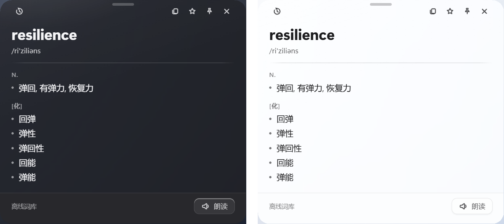
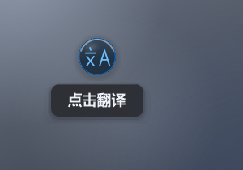
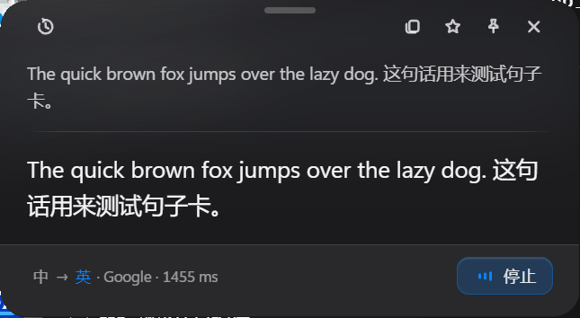
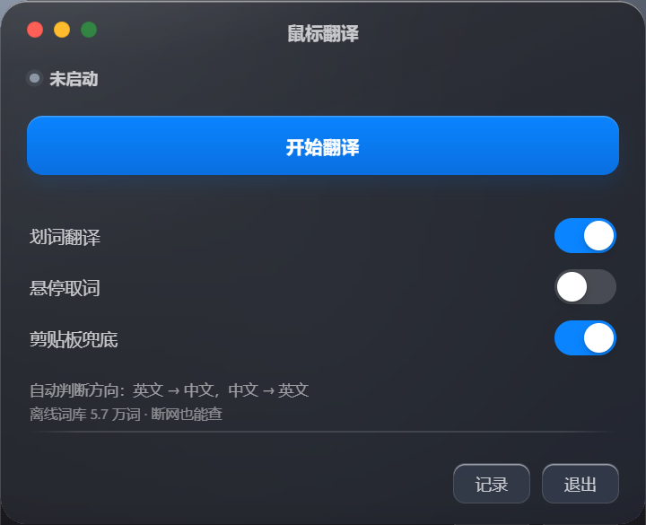

<div align="center">

<h1>鼠标翻译 · Glass Translate</h1>

**划词即译，像玻璃一样安静。**

<sub>Select any text on Windows — a quiet glass card translates it, right beside your cursor.</sub>

<br>

[](https://github.com/OWNER/glass-translate/releases/latest)
[](LICENSE)


<br>

### [⬇ 立即下载 Windows 版](https://github.com/OWNER/glass-translate/releases/latest)

<sub>Windows 10 / 11 · x64 · 下载 zip → 解压 → 双击 <code>安装.bat</code></sub>

</div>

<p align="center">
  
</p>

<p align="center"><sub>深色 / 浅色 · 跟随系统自动切换，并按背景亮度加厚，保持可读</sub></p>

<!--
  上线前请全局替换以下占位符：
  · OWNER                                     → 真实 GitHub 用户名 / 组织名
  · https://github.com/OWNER/glass-translate/releases/latest → 实际 Release 地址
  · https://github.com/OWNER/glass-translate  → 实际仓库地址
  文末另有 LEAD:OWNER 标记。
-->

---

## 选中，然后忘掉它

在任何软件或网页里选中一段文字，光标旁会浮出一枚小徽标。轻点一下，一张玻璃卡片带着译文出现；不弹窗，不抢焦点，按 `Esc` 就散。

<p align="center">
  
</p>

<p align="center"><sub>选中文字，光标旁出现这枚小徽标</sub></p>

---

## 四个理由

<table>
<tr>
<td width="50%" valign="top">
<h3>① 即划即译，零打扰</h3>
<p>选中就出现，点一下才翻译。不抢焦点、不弹窗，<code>Esc</code> 立刻消失。</p>
</td>
<td width="50%" valign="top">
<h3>② Apple 玻璃质感，深浅自适应</h3>
<p>把背后的画面模糊、加饱和、半透明，再叠 1px 描边和内高光。跟随系统深浅色，还会按背景亮度自动加厚，浅色页面上也读得清。</p>
</td>
</tr>
<tr>
<td width="50%" valign="top">
<h3>③ 自然人声，语义断句，点一下即停</h3>
<p>长句按语义断句朗读，缩写、小数、中英混排都不读错；在线神经语音优先，失败自动回落系统音色。点一下即停（实测不到 10 ms）。</p>
</td>
<td width="50%" valign="top">
<h3>④ 取词不污染任何网页</h3>
<p>系统级取词，不注入网页、不加下划线、不改页面。读不到就静默回落，绝不误弹。</p>
</td>
</tr>
</table>

卡片上还能固定、收藏、复制，翻看翻译记录与生词本；朗读只有一个按钮，读原文还是译文自动判断；长文在卡片内部滚动，最高占 60% 屏高。

<p align="center">
  
</p>

<p align="center"><sub>长句朗读中：三根声波表示正在读，点一下即停</sub></p>

---

## 30 秒上手

1. **下载并解压**　在 [Release 页面](https://github.com/OWNER/glass-translate/releases/latest) 下载 `MouseTranslate-v1.0.0-win64.zip`，解压到任意文件夹。
2. **双击 `安装.bat`**　桌面会出现「鼠标翻译」图标；打开它，点面板上的「开始翻译」，窗口就收进托盘。首次运行如果出现「Windows 已保护你的电脑」，点「更多信息 → 仍要运行」就行。
3. **划词试试**　在任意网页或软件里选中一段文字，点光标旁的小徽标。想听发音，按卡片右下角的「朗读」，再点一下即停。双击选词、三击选段也都能用。

<p align="center">
  
</p>

<p align="center"><sub>主面板只有一页：开始翻译、几个开关，没了</sub></p>

每个开关、每个按钮的细节，以及取词原理与更新记录，都写在 [使用说明.md](使用说明.md) 里。

---

## 常见问题

**需要联网吗？**<br>
查单词不需要——内置 5.7 万词离线词库，断网也能查。整句翻译走在线（有道、Google 免费接口），长句会自动联网；在线神经语音也需要网络。网络不通时会自动回落，不会卡住。

**杀毒软件提示有风险？**<br>
程序没有数字签名，Windows 可能提示「未知发布者」，点「更多信息 → 仍要运行」即可。源码全部在本仓库，可以自己构建。

**Win10 还要另外装 WebView2 吗？**<br>
Win11 自带；装过新版 Edge 或任何用到 WebView2 的软件一般也有。安装脚本会自动检测 WebView2，缺了会弹窗提示并给出微软官方下载页。万一打开后界面一片空白，装一下免费的 WebView2 Runtime 即可。

**怎么卸载？**<br>
双击 `%LOCALAPPDATA%\Programs\MouseTranslate\卸载.bat`（安装包里那个 `卸载.bat` 作用相同），程序目录和快捷方式会一起删掉。翻译记录与生词本保留在 `%APPDATA%\MouseTranslate`，想彻底清空就手动删掉这个文件夹。

**支持哪些软件？**<br>
任何能选中文字的软件和网页：Chrome / Edge / Firefox、Word / WPS、PDF 阅读器、微信、记事本、IDE……少数自绘界面（游戏、图片、特殊控件）读不到文字，这时什么都不会弹。

**会上传我的文字吗？**<br>
程序不注入网页、不装扩展、不往系统里写东西，也没有账号和遥测。翻译历史、生词本和设置只存在本机 `%APPDATA%\MouseTranslate`，删掉这个文件夹就回到初始状态。只有你主动使用在线翻译或在线语音时，被处理的那段文字才会发往对应的翻译 / 语音服务。

---

## 项目结构

```text
glass-translate/
├── app/                   程序本体
│   ├── src/               C# 源码：窗口、玻璃材质、取词、翻译、朗读、词库、记录
│   ├── assets/            卡片 / 记录页 HTML、应用图标（dict.bin 不入库，随 Release 分发）
│   ├── lib/               WebView2 SDK 引用（不入库，构建前自行放入，见下节）
│   ├── data/              ECDICT 源数据与词库生成说明（不入库）
│   ├── tools/             词库生成器、截图与端到端测试脚本
│   ├── docs/              开发过程与验证截图（README 展示图另存于 docs/assets/）
│   ├── build.ps1          一键编译
│   └── install.ps1        创建桌面 / 开始菜单快捷方式
├── docs/
│   ├── assets/            README 展示图（hero / badge / speaking / panel）
│   └── dev/               调研与实现方案笔记
├── demo/                  早期网页概念 Demo
├── README.md
├── 使用说明.md             详细使用说明（设置项、取词原理、更新记录）
├── LICENSE
├── RELEASE_NOTES.md       版本说明（发布时作为 Release 正文）
└── publish-github.ps1     一键发布到 GitHub（替换占位符、建仓库、上传安装包）
```

**实现要点**

- **取词**：系统级读屏（UIAutomation）优先；读不到时用剪贴板兜底（Ctrl+C），并完整备份 / 还原剪贴板、校验序列号，过滤拖拽与标题栏误触。
- **界面**：C# WinForms 承载窗口，WebView2 渲染 HTML/CSS 玻璃材质。
- **词库**：ECDICT 精简为 5.7 万词的二进制词库，随包分发。
- **隐私**：无账号、无遥测；历史与生词本写 `%APPDATA%\MouseTranslate`。

---

## 从源码构建

不需要 Visual Studio。Windows 自带的 .NET Framework 4.8 编译器（`csc.exe`）就能编。

**准备**

1. **.NET Framework 4.8**（Windows 10 / 11 自带）。
2. **WebView2 SDK**：从 NuGet 取 `Microsoft.Web.WebView2`，把下面三个文件放进 `app\lib\`（这个目录不入库，需要自己放）：
   - `Microsoft.Web.WebView2.Core.dll`
   - `Microsoft.Web.WebView2.WinForms.dll`
   - `WebView2Loader.dll`（在 `runtimes\win-x64\native\` 里）
3. **离线词库（可选但推荐）**：`app\assets\dict.bin` 不入库，官方发布包里已经内置；从源码构建时按 `app/data/README-词库生成.txt` 的步骤用 ECDICT 生成（下载 `ecdict.csv` → 编译 `app\tools\make-dict.cs` → 输出约 8.8 MB 的 `app\assets\dict.bin`）。没有词库也能构建，只是离线查词不可用。

**构建**

```powershell
git clone https://github.com/OWNER/glass-translate.git
cd glass-translate
powershell -File app\build.ps1
```

产物是 `app\dist\MouseTranslate.exe`。想顺手创建桌面快捷方式：

```powershell
powershell -File app\install.ps1
```

> 如果提示「禁止运行脚本」，把命令换成 `powershell -ExecutionPolicy Bypass -File app\build.ps1`。

---

## 致谢

- [ECDICT](https://github.com/skywind3000/ECDICT)（MIT）—— 离线英汉词库的源数据
- [Microsoft Edge WebView2](https://learn.microsoft.com/microsoft-edge/webview2/) —— 面板与卡片的渲染引擎
- [有道翻译](https://fanyi.youdao.com/)、[Google 翻译](https://translate.google.com/) —— 在线翻译通道
- Windows 系统语音与在线神经语音 —— 朗读
- 视觉语言参考 Apple 的 macOS / iOS 设计；本项目与 Apple 无任何关联。

各版本改了什么，见 [RELEASE_NOTES.md](RELEASE_NOTES.md)。

## License

[MIT](LICENSE)

---

<p align="center"><strong>如果它帮你省下一点查词的时间，欢迎点一个 ⭐ Star。</strong></p>

<p align="center"><a href="https://github.com/OWNER/glass-translate">github.com/OWNER/glass-translate</a></p>

<!-- LEAD:OWNER -->
